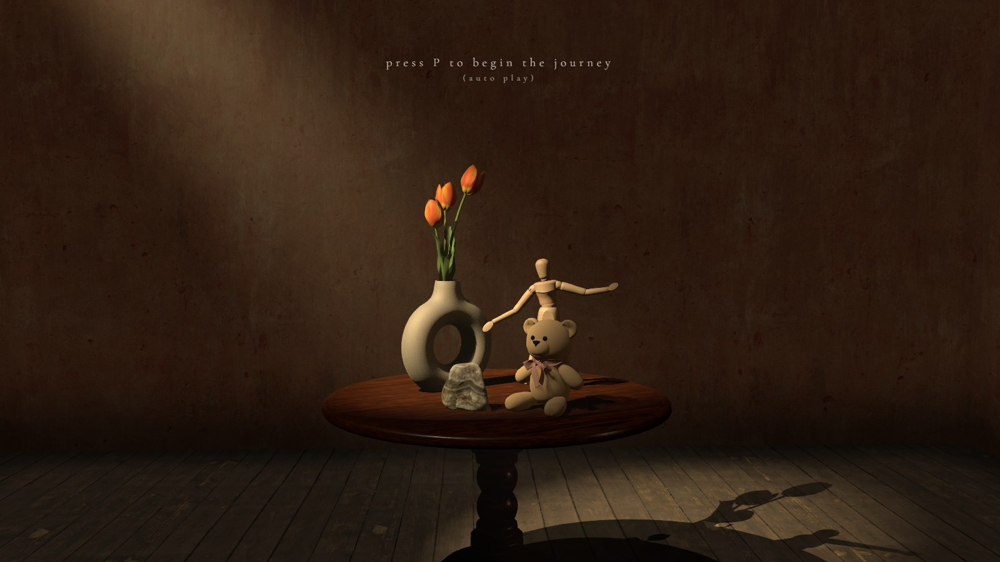
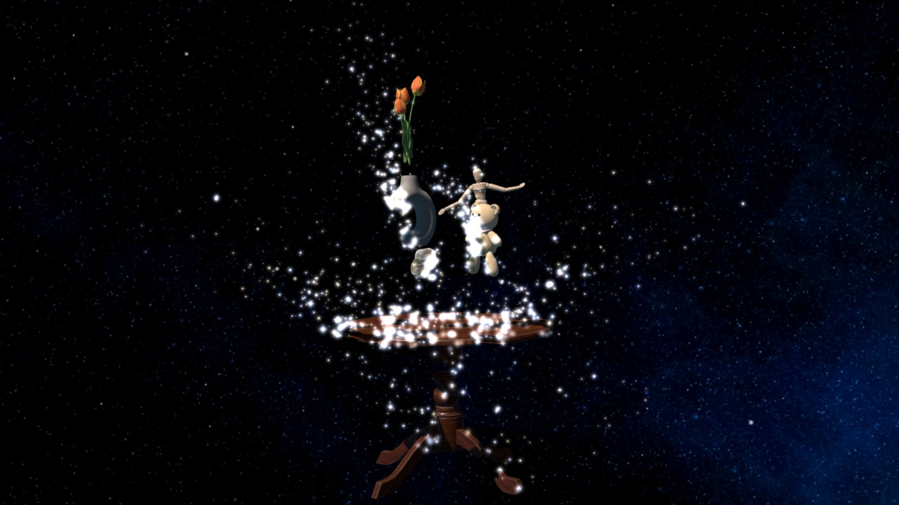
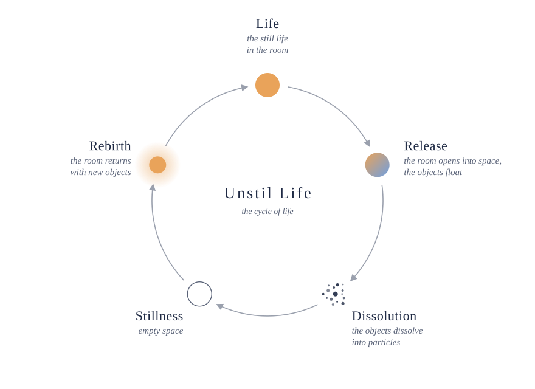

# Unstil Life

A scroll-driven 3D interactive artwork that transitions a classical Still Life room into cosmic space.

**[Live Demo →](https://yeji0205.github.io/unstil-life-yegi-park/)**

<p>
  
  
</p>

The Still Life is a traditional art genre depicting inanimate objects arranged
with care in a controlled spatial setting. This project extends the genre by
introducing a cosmic dimension: the room gradually dissolves into outer space,
and the objects drift into weightlessness before disappearing entirely. Four
objects stand for four forms of existence on Earth: the stone as inanimate
matter, the flower as plant, the teddy bear as animal, and the wooden mannequin
as human. Their slow disappearance carries the central idea that all things are
equally transient from a cosmic perspective, appearing briefly and dissolving
again as part of a continuous cycle.

## The cycle

<p align="center">
  <picture>
    <source media="(prefers-color-scheme: dark)" srcset="docs/cycle-dark.svg">
    
  </picture>
</p>

## How to experience it

| Input | Effect |
|---|---|
| **P** | Plays the whole cycle automatically (the journey). Any scroll or drag hands control back. |
| Scroll up / down | Dissolves the room into space, and brings it back |
| Drag | Looks around the scene (within the room, freely in space) |
| Click or any key | Turns on the sound |

The **Dissolve** button in the debug panel (top right) starts the objects'
disappearance once the scene is in space.

## Run locally

```bash
npm install
npm run dev
```

Check the code with `npm run lint`.

## Documentation

- [implementation_current.md](implementation_current.md): how it is built: the modules, the dissolve shader, lighting, camera and the journey
- [implementation_initial.md](implementation_initial.md): the original plan, kept as a record

## Credits

Built with [three.js](https://threejs.org). Dissolve technique after Codrops,
[Implementing a Dissolve Effect with Shaders and Particles in Three.js](https://tympanus.net/codrops/2025/02/17/implementing-a-dissolve-effect-with-shaders-and-particles-in-three-js/).
Models from [Sketchfab](https://sketchfab.com), skyboxes from
[OpenGameArt](https://opengameart.org/content/space-skyboxes-0), textures from
[Poly Haven](https://polyhaven.com), sounds from [Freesound](https://freesound.org).

Yegi Park, Seminar 3D-Rendering & Computational Art 2026, Hasso Plattner Institute.
